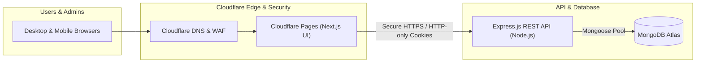

# TaskPulse — Task Management, Attendance & Time Tracking Web Application

**TaskPulse** is a production-ready, full-stack enterprise web application for employee task management, attendance logging, and work-time tracking.

Built with **Next.js (App Router)**, **Express.js**, **MongoDB & Mongoose**, and **TypeScript**, designed for modern SaaS performance with **Cloudflare Pages** frontend delivery and containerized Node.js API hosting.

---

## 🌟 Key Features

### 1. Administrative Suite
* **Command Center Dashboard:** Real-time KPI summary cards (Total employees, active users, currently punched-in count, today's attendance hours, today's task hours, tasks completed, pending approvals, missing punch-outs).
* **Weekly Trend Visualization:** Recharts comparative breakdown of actual attendance duration vs logged task hours.
* **User Directory & Provisioning:** Add employees, auto-generate temporary credentials, 1-click credential copying, activate/deactivate accounts, and perform admin password resets.
* **Attendance Oversight:** Date range filtering, user filtering, missing punch-out alerts, and 1-click Excel (`.xlsx`) & CSV exports.
* **Correction Request Approvals:** Review previous-day missed punches and adjustment justifications; 1-click approve/reject with reviewer comments.
* **Task & Time Log Auditing:** Organization-wide view of all active deliverables and logged hours.
* **Compliance Audit Trail:** Immutable chronological log of logins, failures, attendance events, password changes, and administrative actions.

### 2. User / Employee Workspace
* **Hero Punch Control:** One-click Punch In and Punch Out with live session status in `Asia/Kolkata` timezone.
* **Single Active Session Rule:** Strictly prevents duplicate punch-ins or uninitiated punch-outs.
* **Task Board:** Create deliverables, specify priority (`LOW`, `MEDIUM`, `HIGH`, `URGENT`), and track lifecycle (`TODO`, `IN_PROGRESS`, `BLOCKED`, `COMPLETED`).
* **Direct Time Logging:** Log hours and minutes worked directly against deliverables.
* **Previous-Day Reason Enforcement:** Recording time for yesterday mandates an explanation note (minimum 5 characters).
* **Attendance Corrections:** Submit correction requests for past missed punches with mandatory justification for admin review.
* **Interactive Calendar:** Monthly visual calendar displaying attendance badges, total task hours, overlogged flags, and day drill-down modals.
* **First-Login Security:** Mandatory password update for accounts provisioned with temporary passwords (`mustChangePassword: true`).

---

## 🏗 Technology Stack & Architecture



| Layer | Technologies |
| :--- | :--- |
| **Frontend** | Next.js 16 (App Router), React 19, TypeScript, Tailwind CSS, Lucide React, TanStack Table, Recharts |
| **Backend** | Node.js, Express.js, TypeScript, Mongoose, Zod, ExcelJS, Helmet, Morgan, Express Rate Limit |
| **Database** | MongoDB Atlas (Production) / Local MongoDB (Development) |
| **Authentication** | JWT stored in secure HTTP-only cookies, Bcrypt password hashing, Strict RBAC middleware |
| **Timezone** | `Asia/Kolkata` (Business dates validated strictly on the backend; stored in UTC) |

---

## 📁 Repository Structure

```
teskmanager/
├── package.json              # Monorepo workspace configuration
├── .env.example              # Environment variables template
├── .gitignore
├── README.md
├── server/                   # Express.js REST API
│   ├── src/
│   │   ├── config/           # Database and environment configurations
│   │   ├── constants/        # System roles, statuses, and audit actions
│   │   ├── models/           # Mongoose schemas: User, Attendance, Task, TimeEntry, AuditLog
│   │   ├── middleware/       # JWT auth, roleGuard, errorHandler, rateLimiter
│   │   ├── controllers/      # auth, user, attendance, task, timeEntry, dashboard, report
│   │   ├── routes/           # REST endpoints
│   │   ├── services/         # auditService, timeService
│   │   ├── utils/            # dateUtils (Asia/Kolkata logic), apiResponse
│   │   ├── scripts/          # seedAdmin.ts (bootstrap administrator)
│   │   ├── app.ts            # Express setup and CORS configuration
│   │   └── server.ts         # Server entrypoint
│   └── tests/                # Automated integration test suite
└── client/                   # Next.js App Router Frontend
    ├── src/
    │   ├── app/              # Routes: /login, /set-password, /dashboard, /admin/*
    │   ├── components/       # Design system: Button, Card, Badge, Modal, DataTable, CalendarView
    │   ├── context/          # AuthContext, ThemeContext
    │   ├── lib/              # api client, utils, formatters
    │   └── types/            # Shared TypeScript types
```

---

## 🚀 Getting Started (Local Development)

### 1. Prerequisites
* **Node.js:** v18+ (tested on v26)
* **npm:** v9+
* **MongoDB:** Local MongoDB instance or MongoDB Atlas connection string

### 2. Environment Configuration
Copy the provided `.env.example` to `.env` in the root and in `server/`:
```bash
cp .env.example .env
cp .env.example server/.env
```

Review key configuration variables in `.env`:
```env
PORT=5000
CLIENT_URL=http://localhost:3000
MONGODB_URI=mongodb://127.0.0.1:27017/taskpulse
DEFAULT_TIMEZONE=Asia/Kolkata
JWT_SECRET=super_secret_jwt_key_change_me_in_production_min_32_characters_long
INITIAL_ADMIN_EMAIL=admin@taskpulse.com
INITIAL_ADMIN_PASSWORD=Admin@TaskPulse2026!
```

### 3. Install Dependencies
```bash
npm install
```

### 4. Bootstrap Initial Admin Account
Run the secure seed script to provision the initial administrator:
```bash
npm run seed:admin
```
* **Default Admin Email:** `admin@taskpulse.com`
* **Default Admin Password:** `Admin@TaskPulse2026!`

### 5. Start Development Servers
Start both backend API and frontend client concurrently:
```bash
npm run dev
```
* **Frontend App:** [http://localhost:3000](http://localhost:3000)
* **Backend API:** [http://localhost:5000](http://localhost:5000)
* **API Health Check:** [http://localhost:5000/api/health](http://localhost:5000/api/health)

---

## 🧪 Automated Testing

A comprehensive integration test suite verifies authentication, RBAC boundaries, attendance punch rules, previous-day correction workflows, and task time backdating policies. Tests execute against an isolated in-memory MongoDB server:

```bash
npm test --workspace=server
```

**Verified Test Scenarios:**
- [x] Reject invalid login credentials with 401
- [x] Return authenticated user session via HTTP-only cookie
- [x] Prevent regular employees from accessing administrative endpoints (403 Forbidden)
- [x] Permit employees to punch in for the current business date
- [x] Strictly reject duplicate punch-in on the same day
- [x] Record punch-out and calculate attendance duration
- [x] Reject punch-out when no active session exists
- [x] Reject attendance corrections for future dates
- [x] Permit attendance correction for yesterday with mandatory reason
- [x] Admin review and approval flow for attendance corrections
- [x] Log time against deliverables for today without backdate reason
- [x] Reject logging time for yesterday without explanation reason
- [x] Permit logging time for yesterday with explanation reason
- [x] Block logging time older than yesterday for regular employees

---

## 🌐 Production Deployment Guide (Cloudflare Architecture)

### Frontend Deployment (Cloudflare Pages)
1. In Cloudflare Dashboard, navigate to **Workers & Pages** &rarr; **Create application** &rarr; **Pages** &rarr; **Connect to Git**.
2. Set **Root directory** to `client`.
3. Set **Framework preset** to `Next.js`.
4. Set **Build command** to `npm run build`.
5. Set **Build output directory** to `.next`.
6. Configure Environment Variables in the Pages project settings:
   - `NEXT_PUBLIC_API_URL`: `https://api.yourdomain.com/api`
   - `NEXT_PUBLIC_APP_NAME`: `TaskPulse`
   - `NEXT_PUBLIC_DEFAULT_TIMEZONE`: `Asia/Kolkata`

### Backend Deployment (Node.js Service behind Cloudflare DNS)
1. Deploy `server` to a containerized Node.js host (e.g. Render, Railway, Fly.io, or VPS) with persistent network access.
2. In Cloudflare DNS, configure a CNAME record: `api.yourdomain.com` pointing to your backend host with Cloudflare Proxy (orange cloud) enabled for DDoS and SSL termination.
3. Configure Backend Environment Variables in your hosting dashboard:
   - `NODE_ENV`: `production`
   - `PORT`: `5000`
   - `CLIENT_URL`: `https://yourdomain.com` (your Cloudflare Pages frontend URL)
   - `MONGODB_URI`: `<Your MongoDB Atlas Connection String>`
   - `JWT_SECRET`: `<Secure 64-character hex string>`
   - `COOKIE_SECURE`: `true`
   - `COOKIE_SAME_SITE`: `lax`
   - `DEFAULT_TIMEZONE`: `Asia/Kolkata`
4. Run `npm run seed:admin` once to provision the initial administrator.

---

## 🔒 Security & Privacy Notice
* Plaintext passwords are never stored; all credentials use salted Bcrypt hashes.
* Sessions are signed with JWT and transported via secure HTTP-only, SameSite cookies.
* No invasive background surveillance, screenshots, or keystroke loggers are implemented. All tracking is explicit and transparent.
